# LibreLinkUp for KDE Plasma 6

A Plasma 6 panel widget for **LibreLinkUp**: the current glucose value and
trend arrow in the panel (`5.8 →`), and a 12-hour graph in the popup. On the
desktop it adapts to its size: just the value when small, adding the unit and
age, then the graph, range/average and buttons as you make it bigger. It uses
the same LibreView client as the
[Omarchy widget](https://github.com/aurora7795/omarchy-librelinkup).

> **Not a medical device.** This is a convenience display. Do not use it for
> treatment or dosing decisions. It is not affiliated with or endorsed by
> Abbott. It uses the unofficial LibreView follower API, which can change or
> break without notice, and use may be subject to Abbott's terms.

## Screenshots

| | |
|---|---|
| 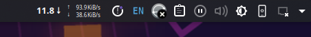 | 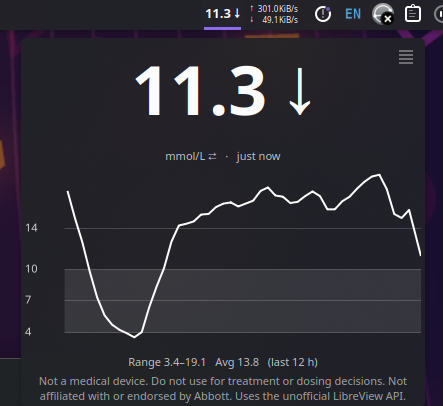 |
| 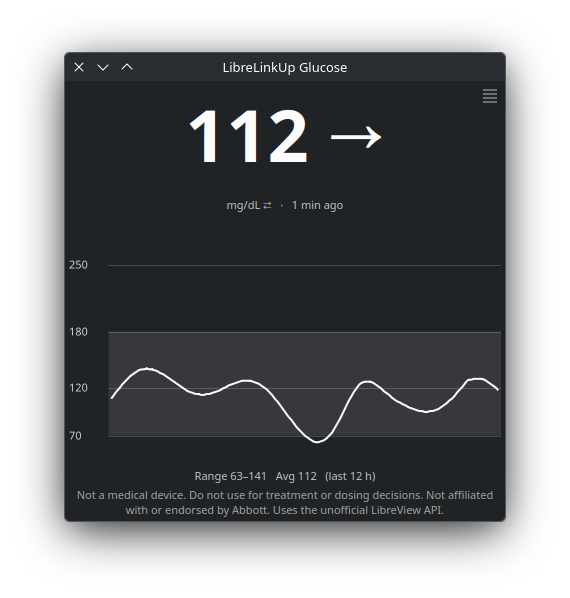 | 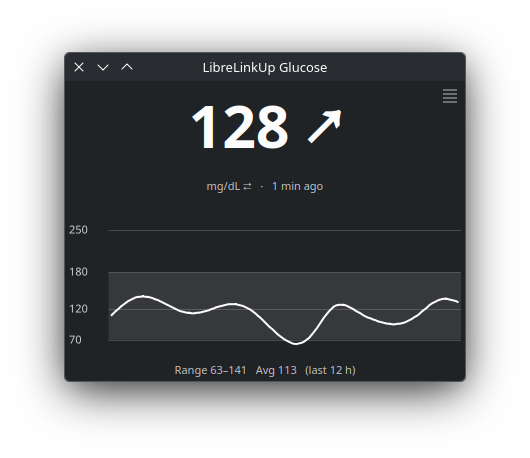 |
| 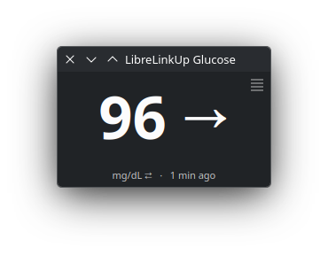 | 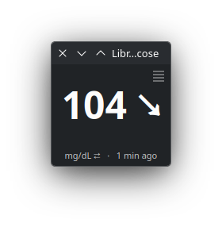 |
| 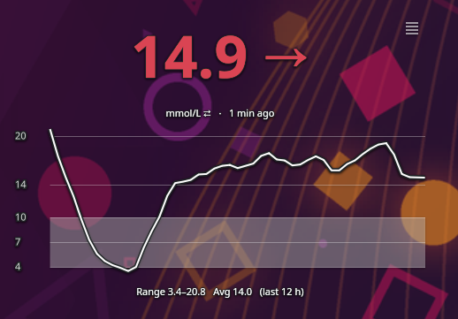 | 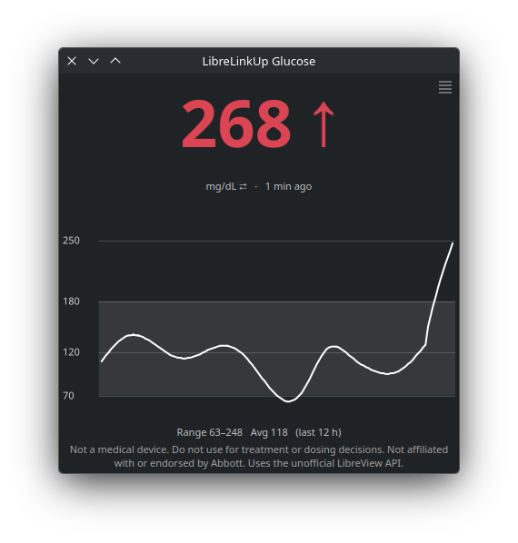 |
| 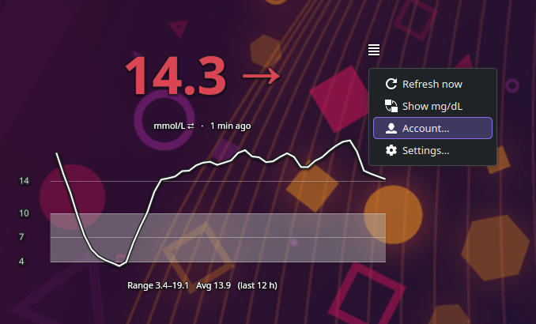 | 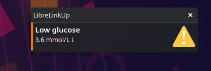 |
| 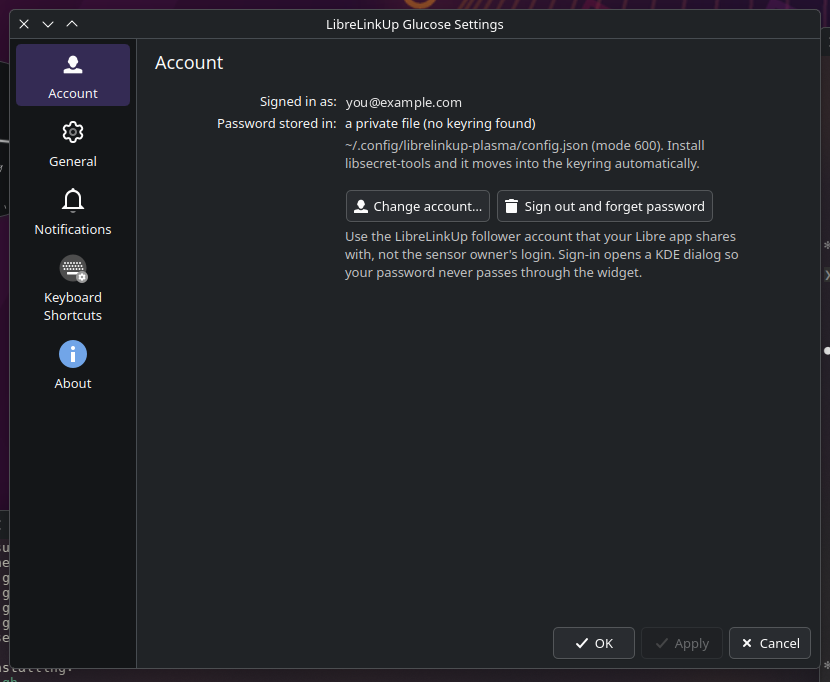 | 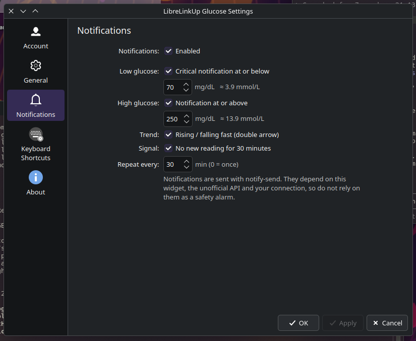 |

## Features

- Value and trend arrow in the panel; red when low or high; `?` appended when
  the reading is over 15 minutes old.
- Popup with large reading, age, 12-hour graph with your target range shaded,
  and range / average. Click the unit label to switch mg/dL and mmol/L.
- On the desktop, switch the widget background off in edit mode (**Show Background**) for a transparent widget; the text and graph get an outline so they stay readable on any wallpaper.
- A **☰** menu in the corner (faint until you hover): Refresh now, switch unit,
  Sign in / Account, Settings. The same actions are in the right-click menu,
  which also works when the widget is too small for the ☰.
- **Configure…** has an **Account** page (who is signed in, where the password
  is kept, change account, sign out and forget the password), **General**
  (unit, refresh interval) and **Notifications**.
- Notifications for low, high, rising/falling fast and lost signal, each with
  its own toggle, plus thresholds and a repeat interval (right-click the widget,
  **Configure…**, **Notifications**).
- Left-click opens the popup, middle-click refreshes.

## Install

```bash
kpackagetool6 -t Plasma/Applet -i org.aurora7795.librelinkup
```

Then right-click the panel, **Add or Manage Widgets…**, and add
**LibreLinkUp Monitor**. To update use `-u` instead of `-i`; to remove use `-r`.
You can try it without a panel using
`plasmawindowed org.aurora7795.librelinkup`.

Requires `python3` (standard library only) and `kdialog` (for sign-in).
`secret-tool` (libsecret) is used for password storage when available, and
`notify-send` (libnotify) for notifications.

## Sign in

Choose **Sign in…** from the ☰ menu or right-click menu (or use **Configure… → Account**). A KDE dialog asks for the **LibreLinkUp
follower** account email and password, the account your Libre app shares
with, not the sensor owner's login. If LibreLinkUp asks you to accept new terms,
do that in the phone app first.

The password is collected by the helper script itself, so it never appears on a
command line or in the environment.

## Where things are stored

| Where | Contents |
|---|---|
| System keyring (`secret-tool`, `service=plasma-librelinkup`) | your password |
| `~/.config/librelinkup-plasma/config.json` | email (permissions 600) |
| `~/.cache/librelinkup-plasma/session.json` | cached session token (permissions 600) |
| Plasma applet config | unit, refresh interval, notification settings |

If no keyring is available (no Secret Service or `secret-tool` missing), the
password is stored **in plain text** in `config.json` (permissions 600). It is
moved into the keyring automatically once one is available. Nothing is sent
anywhere except LibreView (`api*.libreview.io`).

To remove your data:

```bash
secret-tool clear service plasma-librelinkup
rm -rf ~/.config/librelinkup-plasma ~/.cache/librelinkup-plasma
```

Notifications depend on this widget, the unofficial API and your connection,
so do not rely on them as a safety alarm.

## Files

- `org.aurora7795.librelinkup/metadata.json`: plasmoid metadata
- `contents/ui/main.qml`: polling, alert logic, notifications
- `contents/ui/CompactRepresentation.qml`: the panel label
- `contents/ui/FullRepresentation.qml`, `Graph.qml`: the popup and graph
- `contents/ui/config*.qml`, `contents/config/`: settings pages (Account, General, Notifications) and schema
- `contents/code/llu.py`: LibreLinkUp client (login, region redirect, token cache, fetch, `--signin`, `--status`, `--signout`)

## License

MIT, Copyright (c) 2026 Martin Bradford Gago. See `LICENSE`.
